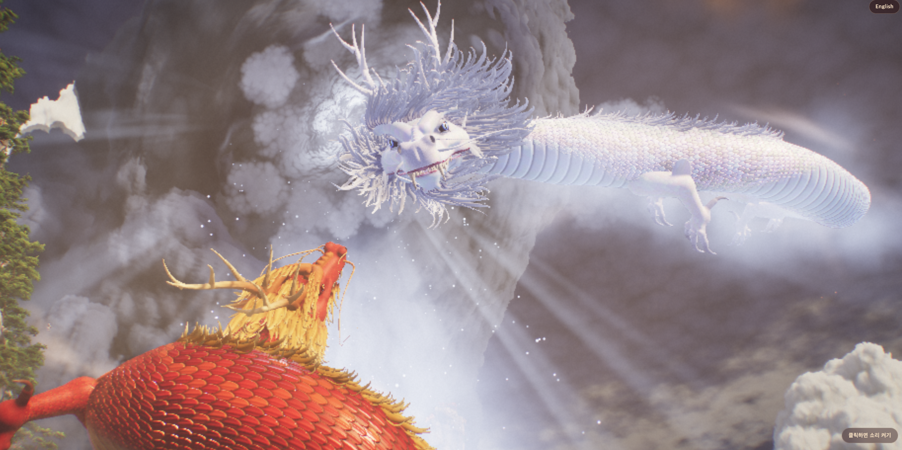

# 적룡(赤龍) · Crimson Loong 한국어판

원본: [ChetasLua/crimson-loong](https://github.com/ChetasLua/crimson-loong) · 데모: [chetaslua.github.io/crimson-loong](https://chetaslua.github.io/crimson-loong/)

이 저장소는 원작 데모의 **화면에 보이는 문구를 한국어로 바꾼 오버레이**입니다. 원작 파일 index.html은 그대로 두고, 표시 시점에 문구만 바꿉니다. 영문 안내는 [README.en.md](README.en.md)에 있습니다.

## 소개

「Crimson Loong」은 ChetasLua가 만든 브라우저 3D 영상(film)입니다. 순수 three.js만으로, 모든 메시·텍스처·음을 코드로 생성해 붉은 용(적룡)이 구름과 산, 붉은 전각 사이를 날아다니는 장면을 보여 줍니다. 원작은 @scottstts의 'Dragon's Nest'에서 영감을 받았다고 밝히고 있습니다. 게임처럼 조작하는 대신 영상이 스스로 재생됩니다.

## 실행 화면

[배포본](https://sigco3111.github.io/crimson-loong-ko/)에서 캡처한 실제 실행 화면입니다.

| 기둥에 감긴 적룡 | 적룡과 백룡 | 산중 전각과 적룡 |
|:-:|:-:|:-:|
|  |  |  |

화면 오른쪽 위의 **English** 버튼은 한국어판이 켜져 있다는 표시이고, 누르면 영문으로 돌아갑니다.

## 보는 방법 · 조작

- 배포 주소를 열면 로딩 후 영상이 자동으로 재생됩니다.
- **클릭/탭**: 소리 켜기 (「클릭하면 소리 켜기」 → 「소리 켜짐」)
- **Space**: 일시정지
- WebGL 2(float 렌더 타깃)를 지원하는 브라우저가 필요합니다.

## 한국어판 특징

- 언어 전환: 우측 상단 버튼(English / 한국어). 주소에 `?lang=en` 또는 `?lang=ko`를 붙이면 해당 언어로 열립니다. 선택은 브라우저에 저장됩니다.
- 번역 방식: 원문을 사전(`i18n/ko.json`)의 키로 보존하고, 페이지의 텍스트를 표시될 때 치환합니다. index.html에는 `` 한 줄만 추가했습니다.
- 번역 범위: 화면에 보이는 짧은 문구 약 25개 전부 — 제목, 부제, 로딩 안내(「용을 깨우는 중」 등), 소리 버튼, 일시정지, WebGL 오류 메시지까지.
- 용어 기준: [docs/glossary.md](docs/glossary.md)
- 외부 폰트, 분석, 외부 서버 호출은 없습니다. 같은 저장소의 `i18n/ko.json`만 추가로 읽습니다. 서비스워커와 오프라인 캐시는 없습니다.
- 한계: 원작 README 같은 문서는 번역하지 않았습니다. 사전을 읽지 못하면(예: 파일을 디스크에서 직접 열 때) 영문으로 보입니다. 로딩 중 잠깐 영문이 보일 수 있습니다.

## 기술 내용

- **원작**: 외부 에셋 파일 없이 단일 `index.html`로 동작하는 순수 three.js 영상입니다. 메시·텍스처·음악 음표까지 모두 코드로 생성하며, WebGL 2의 float 렌더 타깃을 사용합니다.
- **한국어 오버레이**: `ko-overlay.js`가 `i18n/ko.json` 사전을 읽어, 화면에 표시되는 시점에 텍스트 노드만 사전 값으로 바꿉니다. 원문은 사전의 키로 그대로 보존되므로 English 모드에서 원문 그대로 돌아갑니다.

## 라이선스 안내

원본 저장소 ChetasLua/crimson-loong에는 프로젝트 라이선스가 명시되어 있지 않습니다. 원본 README가 밝히는 것은 three.js(MIT) 사용뿐입니다. 이 번역본은 원작자의 명시적 허락 없이 만든 비공식 번역입니다. 원작자나 권리자가 요청하면 이 저장소를 **요청 시 삭제**합니다.

## 배포

GitHub Pages: https://sigco3111.github.io/crimson-loong-ko/
